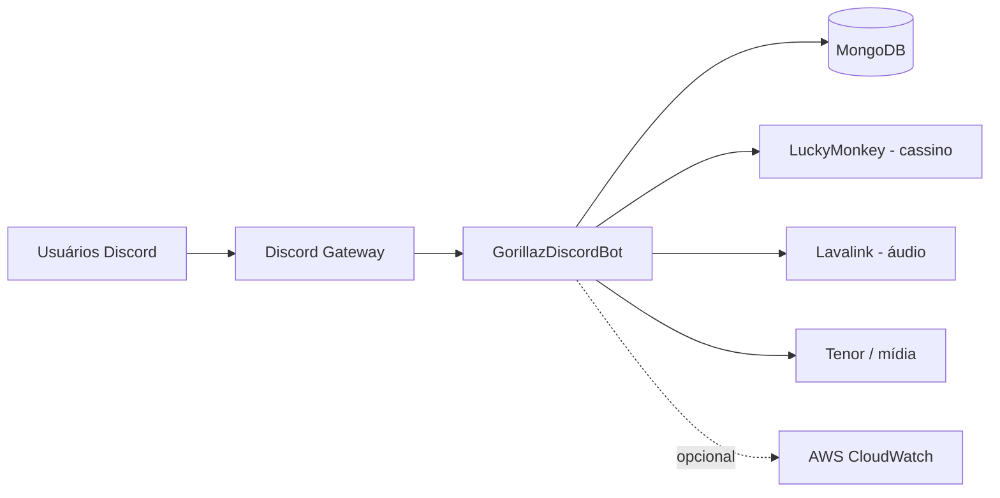
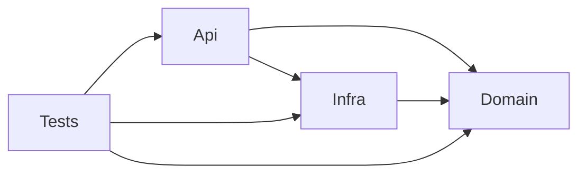
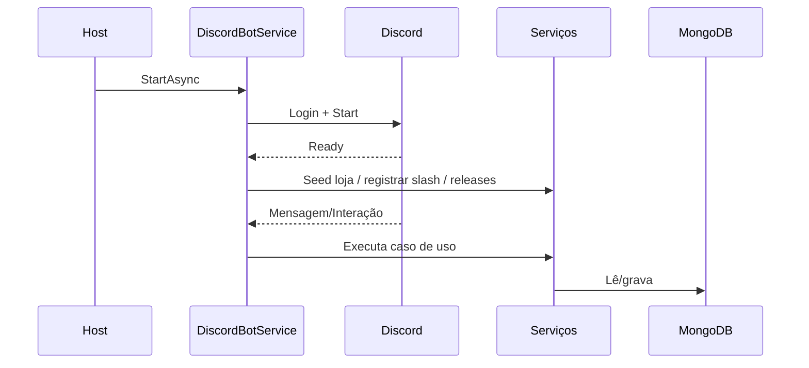

---
tags:
  - arquitetura
  - system-design
tipo: nota
atualizado: 2026-10-10
---

# System Design

[[Home|Home]] · [[Arquitetura|← Arquitetura]]

Visão consolidada de design do **GorillazDiscordBot**: bot Discord em .NET 9, orientado a eventos, com comandos de prefixo e slash commands, persistência em MongoDB, áudio via Lavalink e cassino delegado ao microserviço LuckyMonkey. Entrega em AWS ECS/Fargate via Terraform e GitHub Actions.

## 1. Contexto (C4 — nível sistema)

## 2. Arquitetura em camadas

| Projeto | Responsabilidade |
| --- | --- |
| `GorillazDiscordBot.Domain` | Entidades, regras/políticas e **contratos** (repositórios + serviços), isolado de frameworks. |
| `GorillazDiscordBot.Infra` | MongoDB, repositórios, `MongoMappings` (BSON), Options pattern e Terraform (`AWS/`). |
| `GorillazDiscordBot.Api` | Host (`DiscordBotService`), módulos de comando, serviços de aplicação e `Program.cs` (DI). |
| `GorillazDiscordBot.Tests` | Testes xUnit + NSubstitute + FluentAssertions. |
| `GorillazDiscordBot.Knowledge` | Base de conhecimento (vault Obsidian): arquitetura, comandos, integrações e ADRs. |

## 3. Runtime — composição e ciclo de vida

Componentes em `GorillazDiscordBot.Api/Program.cs` e `DiscordBotService.cs`:

- **Generic Host** com Options pattern: `BotOptions`, `MongoOptions`, `LavalinkOptions`, `AudioUploadOptions`.
- **Singletons de DI**: `DiscordSocketClient`, `CommandService`, `InteractionService`, repositórios, serviços de aplicação e sessões.
- **HostedServices**: `DiscordBotService` (lifecycle Discord e roteamento), `EconomyMaintenanceService` (meia-noite UTC), `ScheduledSoundService`, `AudioUploadCleanupService` e `PersistentVoiceService`.
- **Event sinks** (`IBotEventSink`) modulares: `GuildEventsSink`, `AutoModService`, `GuildLogService`, `RaidGuardService`, `JoinLeaveSoundService` e `PersistentVoiceService`.

Boot: carrega `.env` → garante índices Mongo → login/start → em `ReadyAsync`: seed da loja, registro de slash commands (dev guild ou global), anúncio de releases e start do Lavalink.

## 4. Fluxo de comandos

- **Prefixo** (`DiscordBotService.HandleCommandAsync`): resolve o prefixo por guild via `ISettingsRepository<Guild>` (fallback `COMMAND_PREFIX`, match case-insensitive, fallback de menção). Aplica `CommandPolicyService` (permissões) e `ModuleAccessService` (módulos habilitados). Comando desconhecido → `ChatInteractionService`.
- **Interações** (`DiscordBotService.HandleInteractionAsync`): mesmas políticas para slash; `InteractionService.ExecuteCommandAsync` resolve módulos via reflexão (`[Disabled]` ignora módulo).
- **Módulos**: `Api/Commands/` organizado por área — Casino, Economy, Shop, Profile, Vehicle, Moderation, Config, Audio, Interaction e Release.

## 5. Modelo de dados (MongoDB)

Banco padrão `gorillazbot`. Coleções nomeadas pelo tipo; mapeamentos em `Infra/Configuration/MongoMappings.cs`; índices garantidos no boot (`EnsureIndexesAsync`). Ver [[Arquitetura/Coleções MongoDB|Coleções MongoDB]].

| Coleção | Conteúdo |
| --- | --- |
| `EconomyProfile` / `EconomyTransaction` | Saldo/banco/poupança/boosts + auditoria. |
| `DiscordUserProfile` | Usuário; `MainUserId` (contas vinculadas). |
| `CharacterProfile` | Perfil/personagem (índice único `uq_Profile_UserId`). |
| `ShopItem` / `InventoryItem` | Catálogo + inventário. |
| `RankingTier` / `HallOfFame` | Tiers e hall da fama. |
| `Guild` | Settings embutidos (prefix/welcome/voice) via `SettingsRepository<T>` (upsert + cache). |
| `GuildMember` / `GuildInteraction` / `Gif` / `ReleaseNote` | Moderação, interações, GIFs e releases. |

**Persistente** (MongoDB): economia, guild, loja e releases. **Efêmero** (memória via `ISessionStore`): sessões de quiz/prova/trabalho/manobrista e rastreio de apostas.

Padrão de acesso: `IMongoRepository<T>` genérico + repositórios especializados; `SettingsRepository<T>` com cache concorrente e upsert.

## 6. Integrações externas

| Integração | Uso |
| --- | --- |
| Discord.Net | Gateway, comandos prefixados, slash, botões e modais. |
| MongoDB Driver | Persistência de domínio e configuração. |
| Lavalink4NET + sidecar Lavalink | Áudio (YouTube, Myinstants, uploads e `local:`). Ver [[Integrações/Discord]]. |
| LuckyMonkey (HTTP + `X-Api-Key` + JWT) | Sessões e jogos de cassino (`CasinoApiClient`, `PayoutService`). Ver [[Integrações/LuckyMonkey]]. |
| Tenor | Normalização de URLs de mídia. Ver [[Integrações/Tenor]]. |
| AWS CloudWatch | Destino opcional de logs (`AWS_LOG_GROUP` / `AWS_REGION`). Ver [[Integrações/AWS]]. |

## 7. Deploy (AWS ECS/Fargate)

- `Dockerfile` (imagem Linux) e `docker-compose.yml` local (MongoDB + Lavalink + bot).
- `task-definition.template.json`: **3 containers** na mesma task → `bot`, `lavalink` (:2333) e `luckymonkey` (:8080), comunicando via `localhost`.
- Segredos via **Secrets Manager** (`DISCORD_TOKEN`, `MONGODB_*`, `LUCKY_MONKEY_*`, `OWM_API_KEY`, `LAVALINK_PASSWORD`).
- Infra: `Infra/AWS/` (Terraform — networking, ECR, ECS, secrets) + `main.tf`.
- CI/CD: `.github/workflows/ci.yml` (build + testes) e `aws.yml` (build → ECR → deploy ECS).

## 8. Decisões e qualidade

- **ADR-0002** — *seams* de domínio (`IPrimaryAccountResolver`, `IWalletService`, `IShopService`, `IAltSanctionPolicy`, `ISessionStore`) implementados hoje na Api, prontos para extração do serviço **Coinflux** (adaptadores HTTP em `Api/Gateways/`). Ver [[Decisões/ADR-0002 - Padrão de extração de serviço (Coinflux)|ADR-0002]].
- `TreatWarningsAsErrors` + analyzers (`.editorconfig`, `Directory.Build.props`).
- Pacote privado `LuckyMonkey.Contracts` (GitHub Packages) requer `NUGET_AUTH_TOKEN` com `read:packages` no build.

## Referências

- `GorillazDiscordBot.Api/Program.cs`
- `GorillazDiscordBot.Api/DiscordBotService.cs`
- `GorillazDiscordBot.Infra/Repository/`
- `GorillazDiscordBot.Domain/Entity/`
- `task-definition.template.json`
- [[Arquitetura/Visão geral|Visão geral]] · [[Arquitetura/Backend|Backend]] · [[Arquitetura/Banco de dados|Banco de dados]] · [[Arquitetura/Infraestrutura|Infraestrutura]]
